# Lab 3: Static Routing with Floating Backup Routes

**Tool:** Cisco Packet Tracer 9.0
**Topology:** New build (three routers in a triangle, separate from Labs 1 and 2)

## Objective
Connect three LANs across a triangle of routers using static routes, add floating static routes as backup paths, and test what happens when a link fails.

## Topology
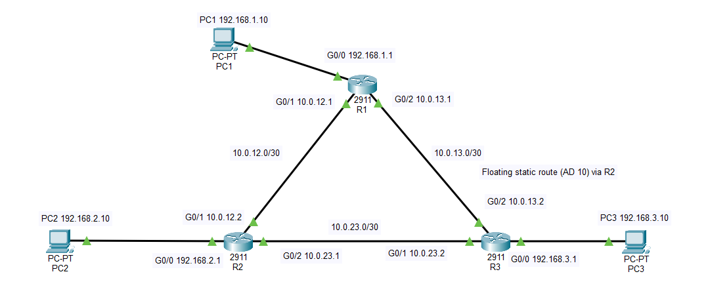

| Device | Interface | Address |
|---|---|---|
| R1 | G0/0 (LAN) | 192.168.1.1/24 |
| R1 | G0/1 (to R2) | 10.0.12.1/30 |
| R1 | G0/2 (to R3) | 10.0.13.1/30 |
| R2 | G0/0 (LAN) | 192.168.2.1/24 |
| R2 | G0/1 (to R1) | 10.0.12.2/30 |
| R2 | G0/2 (to R3) | 10.0.23.1/30 |
| R3 | G0/0 (LAN) | 192.168.3.1/24 |
| R3 | G0/1 (to R2) | 10.0.23.2/30 |
| R3 | G0/2 (to R1) | 10.0.13.2/30 |
| PC1 / PC2 / PC3 | NIC | 192.168.1.10 / 192.168.2.10 / 192.168.3.10 (gateway = own router's G0/0) |

Configs: [R1](R1-config.txt), [R2](R2-config.txt), [R3](R3-config.txt)

## What I configured
- Interface addressing on all routers, with /30 subnets on the router-to-router links
- Static routes on each router to every network it isn't directly connected to (`ip route <network> <mask> <next-hop>`)
- Floating static routes (administrative distance 10) on R1 and R3 as backups via R2, so they stay out of the routing table until the primary route disappears

## Verification
| Test | Result |
|---|---|
| Direct neighbour pings | 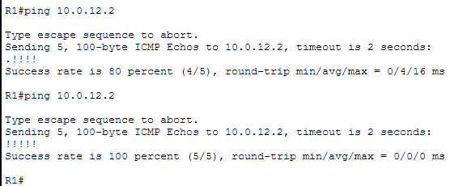 |
| Static routes on R1 (backup hidden) | 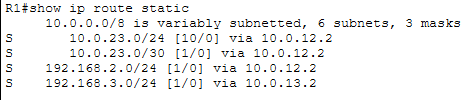 |
| PC1 to PC3 ping and tracert (direct path) | 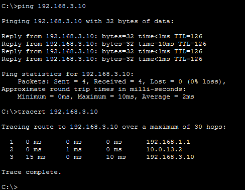 |
| Floating route in the config (AD 10) |  |

## Link failure test
I shut down R1's `g0/2` (the R1-R3 link) to see the backup route take over.

1. After `shutdown`, the route to 192.168.3.0/24 changed from `[1/0] via 10.0.13.2` to `[10/0] via 10.0.12.2`.
   
2. PC1's tracert now goes through R2.
   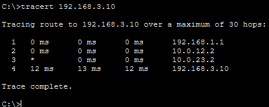
3. After `no shutdown`, the primary route returned and traffic went back to the direct path.
   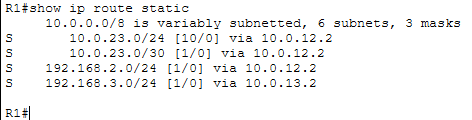
   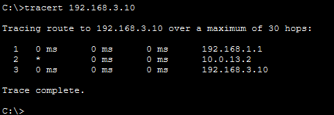

## Troubleshooting: missing return route
- **Scenario:** with the R1-R3 link down, I removed R3's backup route to 192.168.1.0/24.
- **Symptom:** PC1 could not reach PC3, and the tracert stopped after R2.
  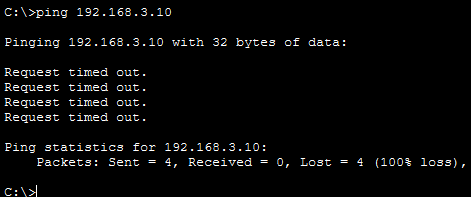
  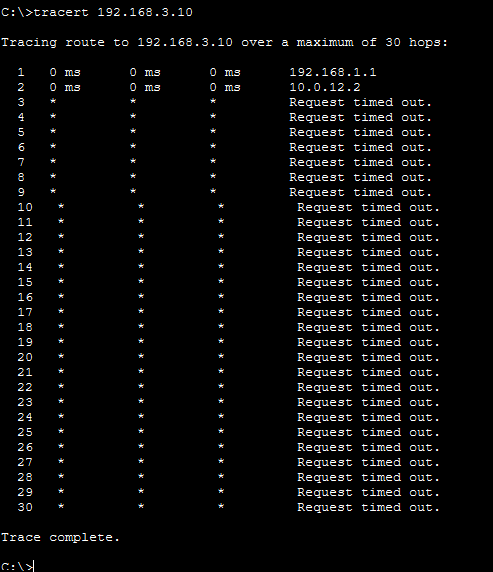
- **Diagnosis:** R1 and R2 had working routes, but `show ip route 192.168.1.0` on R3 returned "Network not in table". Packets reached PC3, but the replies had no path back.
  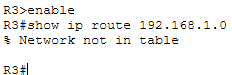
- **Fix:** restored the floating route on R3: `ip route 192.168.1.0 255.255.255.0 10.0.23.1 10`.
  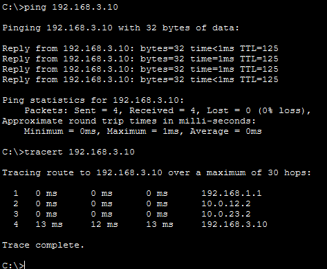

## Key takeaways
- Routing has to work in both directions. A backup route on one router isn't enough.
- A floating static route has a higher administrative distance, so it only appears in the table when the primary route is gone.
- Static routes don't detect remote failures. They only react when the local interface goes down. This is why dynamic routing (OSPF, in Lab 4) is used on larger networks.
